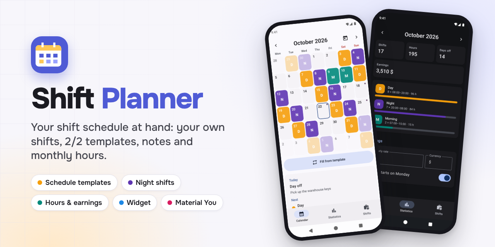
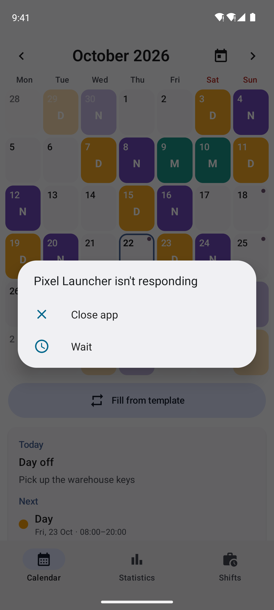
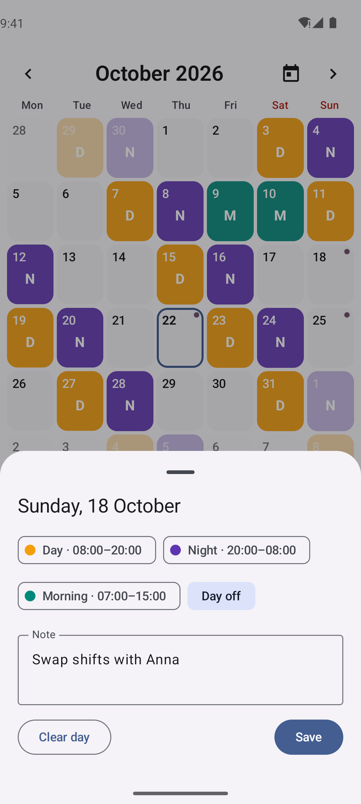
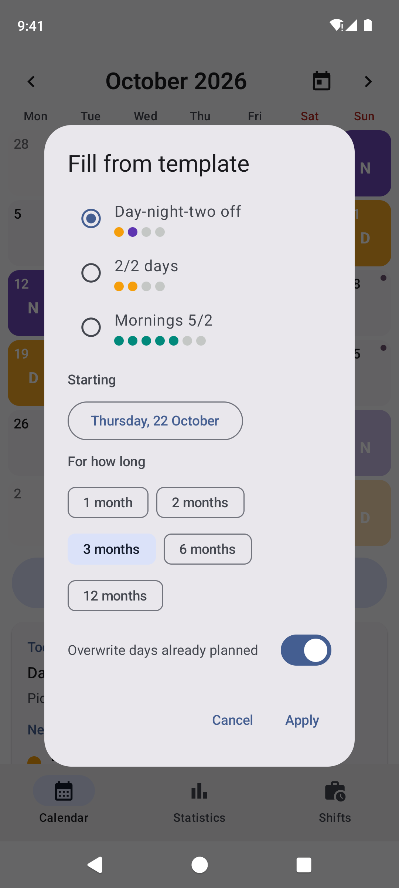
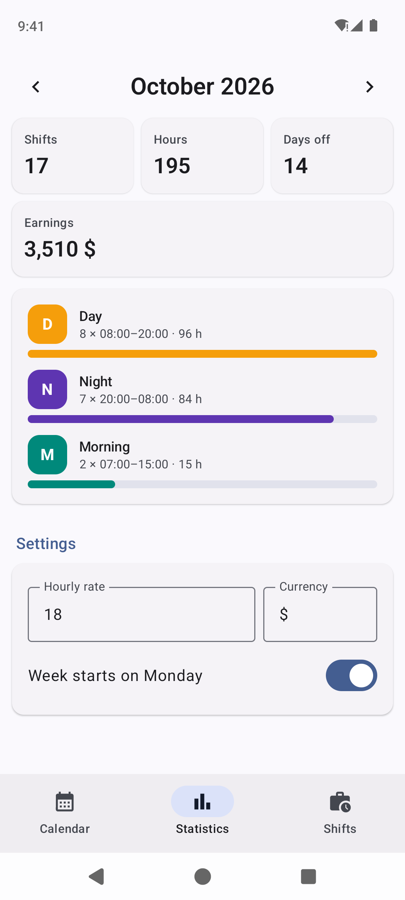
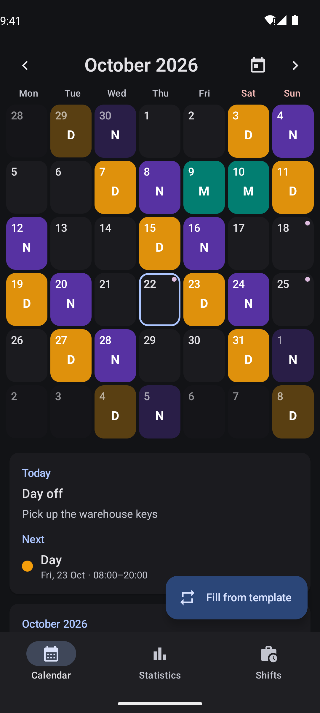
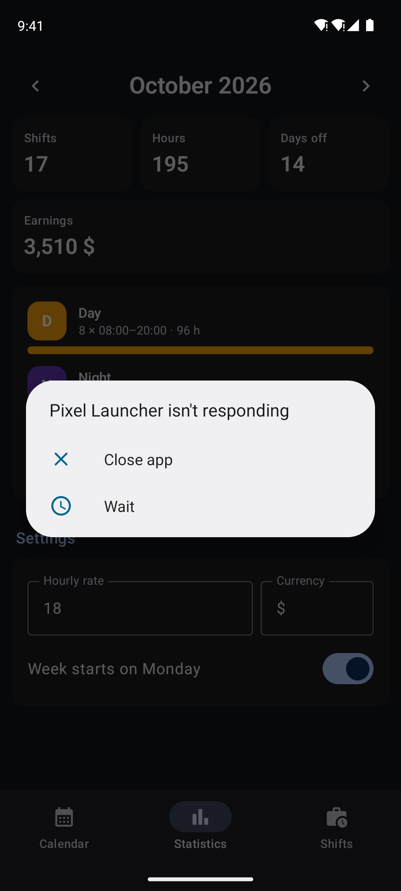
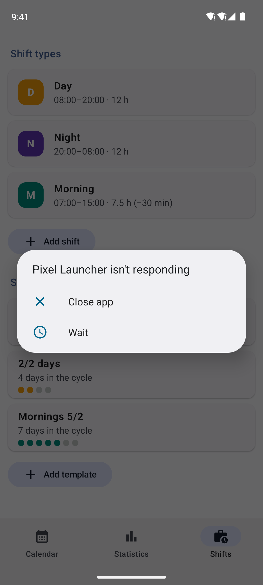
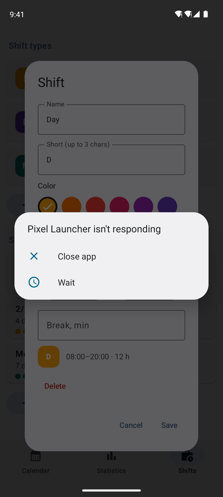

<p align="center">
  
</p>

<p align="center">
  <a href="https://github.com/hatogg/Shift-Planner-/releases/latest"></a>
  <a href="https://github.com/hatogg/Shift-Planner-/actions/workflows/build.yml"></a>
  
  
  <a href="LICENSE"></a>
</p>

<p align="center"><a href="README.md">Українська</a> &nbsp;|&nbsp; <b>English</b></p>

**Shift Planner** is a work shift calendar for Android. Create your own shifts (day, night, morning — anything, with your own colour and hours), lay out a 2/2 or day-night-two-off schedule months ahead with a template, and see your hours and earnings for the month. No ads, no sign-up, no internet.

<p align="center">
  <a href="https://github.com/hatogg/Shift-Planner-/releases/latest"></a>
</p>

<p align="center">
  
  
  
  
</p>
<p align="center">
  
  
  
  
</p>

<sub>Real screenshots: GitHub Actions runs the app in an Android 14 emulator and walks through the screens with demo data.</sub>

## Features

| | |
| --- | --- |
| 🗓️ **Calendar** | A full-screen month, swipe between months, a “today” button. Every day shows a coloured shift label; a dot means there's a note. |
| ✏️ **Your own shifts** | Name, short label (D, N, M…), colour from a palette, start and end, break. A 20:00–08:00 night counts as 12 hours, not minus 12. |
| 🔁 **Schedule templates** | 2/2, day-night-two-off, 5/2 or any cycle of your own. “Fill from template” lays it out from a chosen date for 1–12 months — overwriting or only into empty days. |
| 📝 **Notes** | For any day: “swap shifts”, “medical at 10:00”. The month's notes are listed under the calendar. |
| 📊 **Statistics** | Shifts, hours and days off for the month, a breakdown by shift type and earnings at an hourly rate in your currency. |
| 📱 **Widget** | Today's and next shift and the coming 7 days as a coloured strip, right on the home screen. |
| 🎨 **Material You** | On Android 12+ the colours follow your wallpaper. Light and dark theme. Ukrainian or English, following the phone's language. |

## Installation

1. On your phone, open the [latest release](https://github.com/hatogg/Shift-Planner-/releases/latest) and download `ShiftPlanner-<version>.apk`.
2. Open the downloaded file. Android asks to allow installs from your browser or file manager — allow it.
3. **Install** → **Open**.

Requires Android 8.0 or newer. New versions install over the old one and keep your data.

**Widget:** long-press the home screen → **Widgets** → **Shift Planner** → “My shift”.

## Getting started

1. **Shifts** — check the ready-made Day, Night and Morning shifts or create your own: name, colour, hours.
2. **Calendar** → **Fill from template** — pick a cycle, a start date and how many months.
3. Tap any day to change its shift, make it a day off or add a note.
4. **Statistics** — enter your hourly rate and the app works out the month's earnings.

## Privacy

The app has **no internet permission** — it sends nothing and shows no ads. All data lives in one file in the app's storage on your phone; it can reach the cloud only as part of your Android backup, if you have that turned on.

## For developers

Kotlin, Jetpack Compose, Material 3, Glance (widget), kotlinx.serialization. No database and no third-party services.

```
app/src/main/java/ua/x44to/shiftplanner/
├── MainActivity.kt        ← bottom navigation: Calendar · Statistics · Shifts
├── data/
│   ├── Models.kt          ← ShiftType, DayEntry, Pattern, Settings, AppData
│   ├── Store.kt           ← data in a JSON file, every change, widget refresh
│   └── Strings.kt         ← Ukrainian and English texts, dates
├── ui/                    ← CalendarScreen, DayDialogs, ShiftsScreen, StatsScreen, Theme
└── widget/                ← the “My shift” widget (Glance)
```

- **Build:** Android Studio or `./gradlew assembleRelease` (JDK 17, Android SDK 35).
- **GitHub Actions** ([build.yml](.github/workflows/build.yml)) builds the APK on every push to `main` and publishes it to the `v<versionName>` release. Compile errors show up right on the run page.
- **Screenshots** ([screenshots.yml](.github/workflows/screenshots.yml)) come from an Android 14 (Pixel 7) emulator: a test walks the screens in Ukrainian and English, light and dark, and commits the PNGs to `docs/screens`.
- **Signing:** the key `signing/shiftplanner.jks` is in the repository so every build installs over the previous one. For Google Play, replace it with your own and pass the passwords as the `SP_STORE_PASS` / `SP_KEY_PASS` secrets.

## License

[MIT](LICENSE) © x44to
