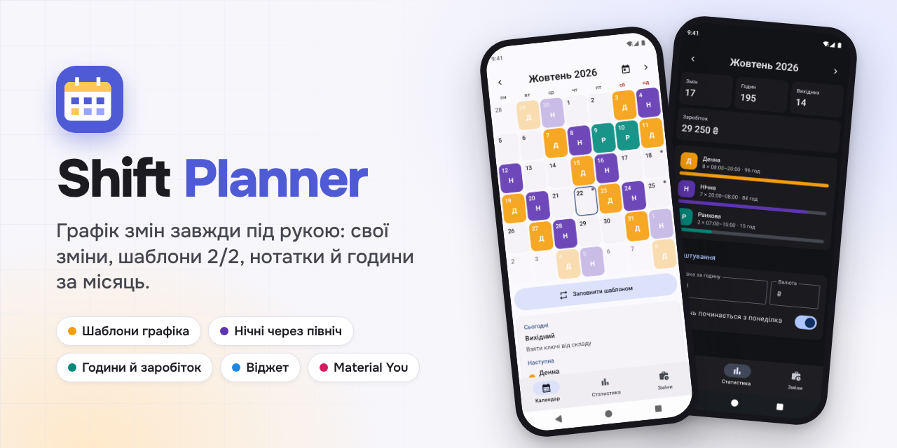
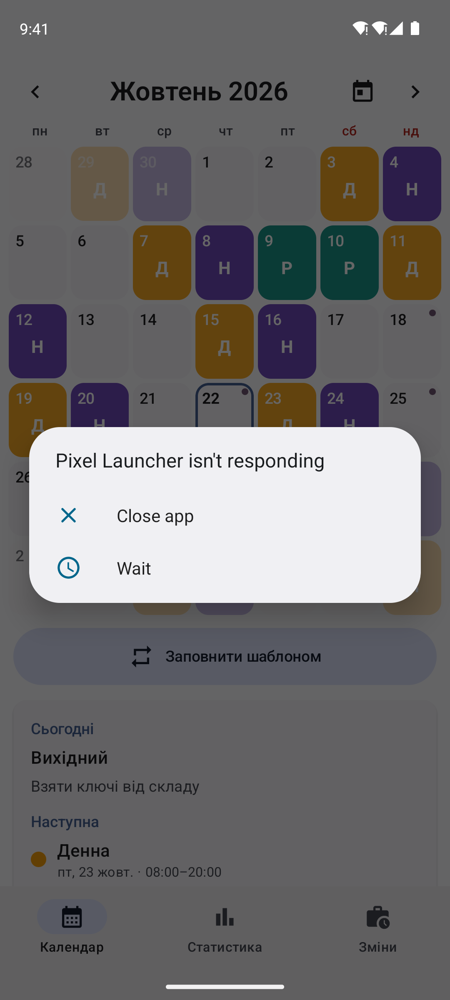
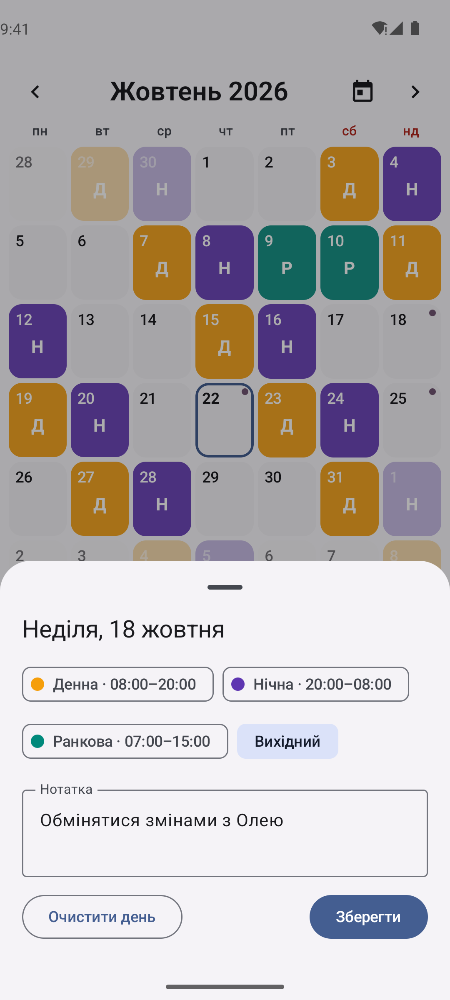
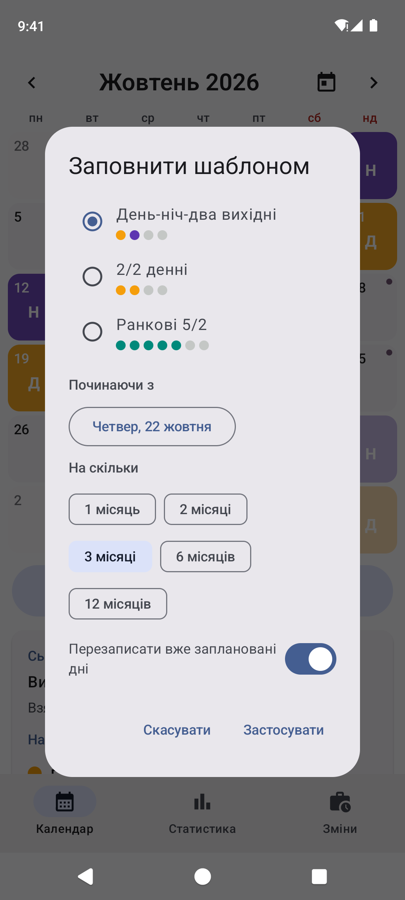
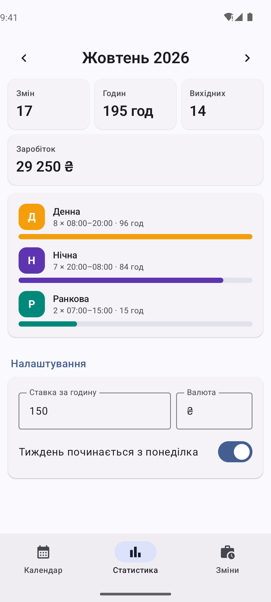
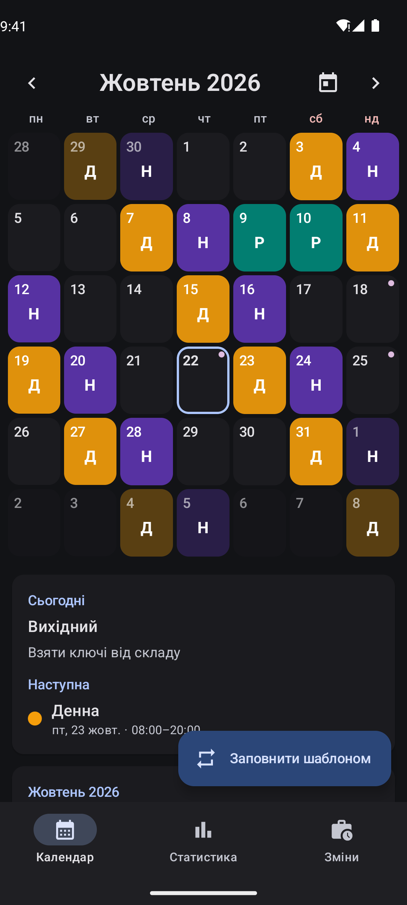
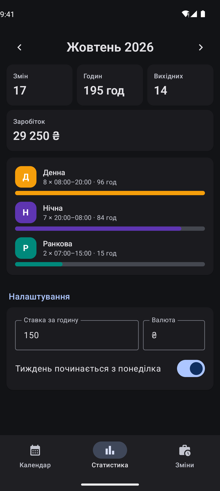
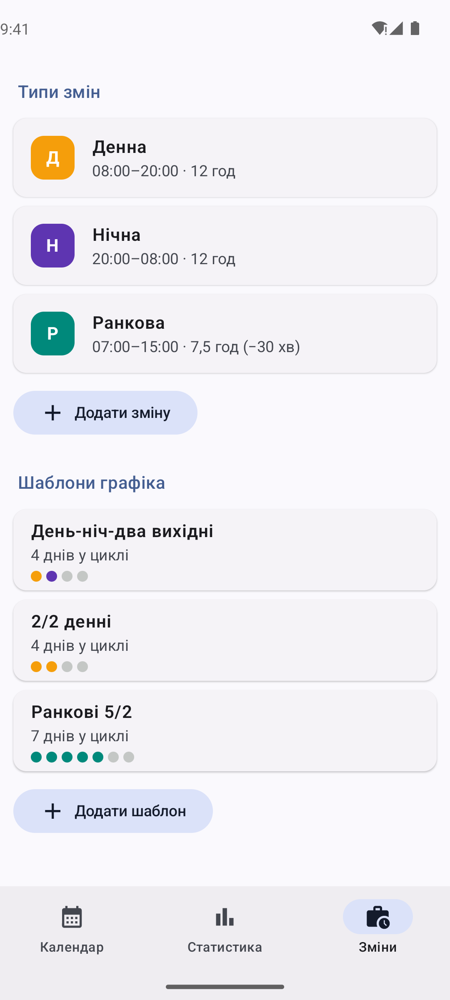
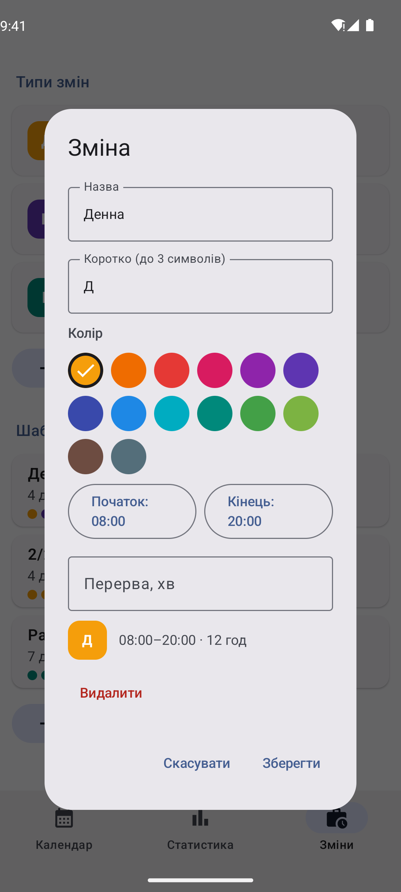

<p align="center">
  
</p>

<p align="center">
  <a href="https://github.com/hatogg/Shift-Planner-/releases/latest"></a>
  <a href="https://github.com/hatogg/Shift-Planner-/actions/workflows/build.yml"></a>
  
  
  <a href="LICENSE"></a>
</p>

<p align="center"><b>Українська</b> &nbsp;|&nbsp; <a href="README.en.md">English</a></p>

**Shift Planner** — календар робочих змін для Android. Створіть свої зміни (денна, нічна, ранкова — будь-які, зі своїм кольором і часом), розкладіть графік шаблоном 2/2 чи день-ніч-два вихідні на кілька місяців наперед і бачте години й заробіток за місяць. Без реклами, без реєстрації, без інтернету.

<p align="center">
  <a href="https://github.com/hatogg/Shift-Planner-/releases/latest"></a>
</p>

<p align="center">
  
  
  
  
</p>
<p align="center">
  
  
  
  
</p>

<sub>Справжні скриншоти: GitHub Actions запускає застосунок в емуляторі Android 14 і проходить екрани з демо-даними.</sub>

## Можливості

| | |
| --- | --- |
| 🗓️ **Календар** | Місяць на весь екран, гортання пальцем, кнопка «сьогодні». У кожному дні — кольорова позначка зміни, крапка — є нотатка. |
| ✏️ **Свої зміни** | Назва, коротка позначка (Д, Н, Р…), колір із палітри, початок і кінець, перерва. Нічна 20:00–08:00 рахується як 12 годин, а не мінус 12. |
| 🔁 **Шаблони графіка** | 2/2, день-ніч-два вихідні, 5/2 або будь-який свій цикл. «Заповнити шаблоном» розкладає його з вибраної дати на 1–12 місяців — з перезаписом або лише в порожні дні. |
| 📝 **Нотатки** | До будь-якого дня: «обмін змінами», «медогляд о 10:00». Нотатки місяця — списком під календарем. |
| 📊 **Статистика** | Зміни, години й вихідні за місяць, розподіл по типах змін і заробіток за погодинною ставкою у вашій валюті. |
| 📱 **Віджет** | Сьогоднішня й наступна зміна та найближчі 7 днів кольоровою смужкою — прямо на головному екрані. |
| 🎨 **Material You** | На Android 12+ кольори підлаштовуються під шпалери. Світла й темна тема. Українська або англійська — за мовою телефона. |

## Встановлення

1. На телефоні відкрийте [останній реліз](https://github.com/hatogg/Shift-Planner-/releases/latest) і завантажте `ShiftPlanner-<версія>.apk`.
2. Відкрийте завантажений файл. Android попросить дозволити встановлення з браузера чи файлового менеджера — дозвольте.
3. **Встановити** → **Відкрити**.

Потрібен Android 8.0 або новіший. Нові версії ставляться поверх старої, дані зберігаються.

**Віджет:** довго натисніть на головному екрані → **Віджети** → **Shift Planner** → «Моя зміна».

## Як почати

1. **Зміни** — перевірте готові «Денна», «Нічна», «Ранкова» або створіть свої: назва, колір, час.
2. **Календар** → **Заповнити шаблоном** — виберіть цикл, дату початку і на скільки місяців.
3. Натисніть на будь-який день, щоб змінити зміну, поставити вихідний чи дописати нотатку.
4. **Статистика** — вкажіть ставку за годину, і застосунок порахує заробіток за місяць.

## Приватність

Застосунок **не має дозволу на інтернет** — нічого не надсилає і не показує реклами. Усі дані лежать в одному файлі в пам'яті застосунку на телефоні; у хмару вони можуть потрапити хіба що разом із резервною копією Android, якщо вона увімкнена у вас у налаштуваннях.

## Для розробників

Kotlin, Jetpack Compose, Material 3, Glance (віджет), kotlinx.serialization. Без бази даних і сторонніх сервісів.

```
app/src/main/java/ua/x44to/shiftplanner/
├── MainActivity.kt        ← нижня навігація: Календар · Статистика · Зміни
├── data/
│   ├── Models.kt          ← ShiftType, DayEntry, Pattern, Settings, AppData
│   ├── Store.kt           ← дані в JSON-файлі, усі зміни, оновлення віджета
│   └── Strings.kt         ← тексти українською й англійською, дати
├── ui/                    ← CalendarScreen, DayDialogs, ShiftsScreen, StatsScreen, Theme
└── widget/                ← віджет «Моя зміна» (Glance)
```

- **Збірка:** Android Studio або `./gradlew assembleRelease` (JDK 17, Android SDK 35).
- **GitHub Actions** ([build.yml](.github/workflows/build.yml)) збирає APK на кожен push у `main` і викладає його в реліз `v<versionName>`. Помилки компіляції видно прямо на сторінці запуску.
- **Скриншоти** ([screenshots.yml](.github/workflows/screenshots.yml)) знімає емулятор Android 14 (Pixel 7): тест проходить екрани українською й англійською, у світлій і темній темі, і комітить PNG у `docs/screens`.
- **Підпис:** ключ `signing/shiftplanner.jks` лежить у репозиторії, щоб кожна збірка ставилася поверх попередньої. Для Google Play замініть його своїм і передайте паролі секретами `SP_STORE_PASS` / `SP_KEY_PASS`.

## Ліцензія

[MIT](LICENSE) © x44to
